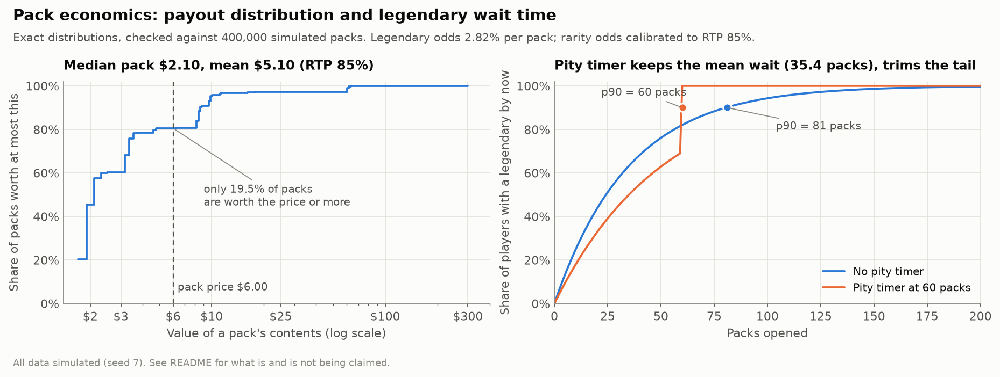
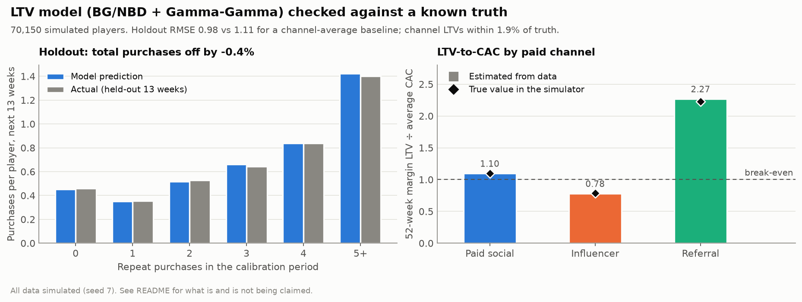
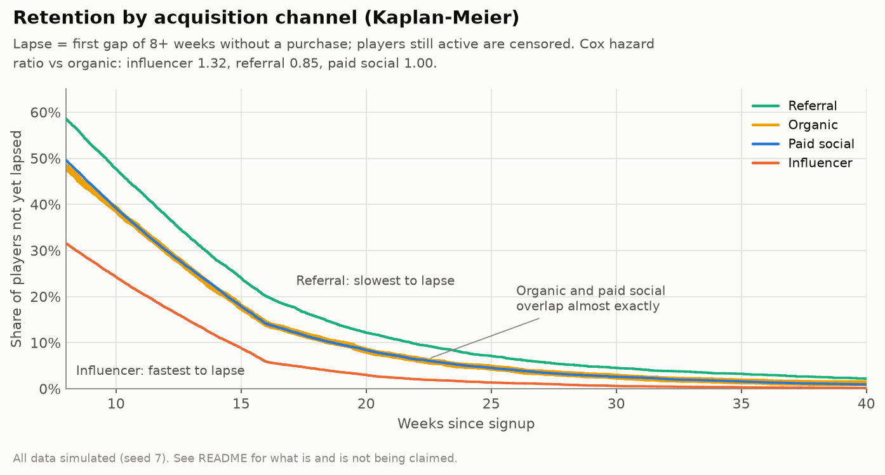
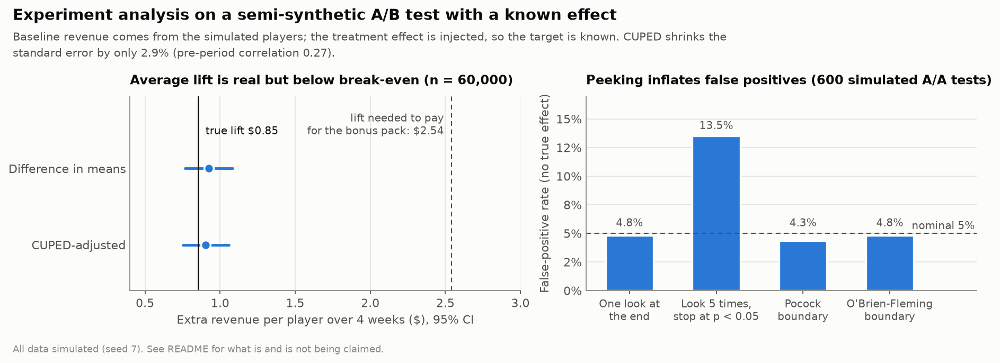
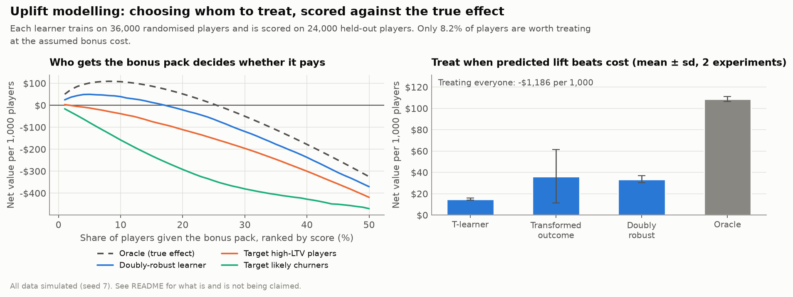
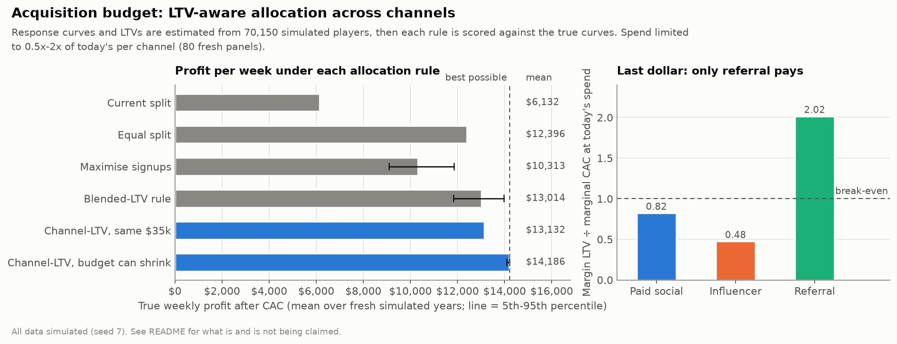
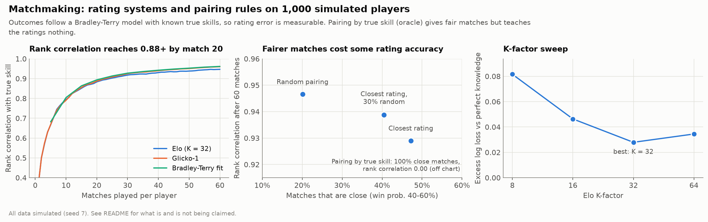

# game-economy-lab

A pack-economy analytics project on a **fully simulated** card-game player base: pack odds and payout
distributions, lifetime value, retention, A/B testing and uplift targeting, acquisition budget
allocation, and matchmaking ratings. Pure Python plus a SQL layer (SQLite). No Databricks, no Spark.

**Everything here is simulated.** There is no real player data. That is deliberate: the simulator
knows the true parameters, so every method is scored against the truth instead of against its own
output. It also means no result below is a finding about any real game. Every number that looks like a
business conclusion (for example, "influencer spend loses money") follows from parameters *I chose*
in `geconomy/simulate.py`, `geconomy/packs.py` and `geconomy/economics.py`. What the project shows is
that the methods recover those choices correctly, and where they don't, by how much.

```
pip install -r requirements.txt
python run_all.py          # full run, about 40 seconds, writes results/ and figures/
python run_all.py --fast   # fewer replicates (smoke test)
python -m pytest -q        # 58 tests, about 40 seconds
```

All seeds are fixed. Two clean full runs produce identical `results/summary.json` contents.

## What is in the repo

| Module | What it does |
|---|---|
| `packs.py` | Tiered pack odds; exact payout distribution by convolution; return-to-player (RTP) and rarity calibration; pity-timer rate equivalence; exact set-completion time through an absorbing Markov chain over owned-card bitmasks |
| `simulate.py` | Player simulator with known truth: BG/NBD purchase process and Gamma-Gamma spend by channel; weekly acquisition from a spend-to-signups power law |
| `ltv.py` | BG/NBD and Gamma-Gamma fitted by maximum likelihood (closed-form likelihood, probability alive, conditional expected purchases), discounted LTV, holdout validation, parameter recovery |
| `sql_metrics.py` | KPI queries in SQL (recursive CTE cohorts, window functions, NTILE), cross-checked against pandas |
| `retention.py` | Kaplan-Meier with Greenwood intervals, log-rank, Cox proportional hazards with a negative-control covariate |
| `experiment.py` | Randomization checks (SRM, standardized mean differences), difference in means, CUPED, MDE and power, re-randomization study, peeking study and group-sequential bounds, uplift learners (T-learner, transformed outcome, cross-fitted doubly-robust), Qini |
| `acquisition.py` | Response curves by Poisson GLM with robust standard errors; LTV-aware budget allocation by Lagrangian water-filling with spend bounds |
| `matchmaking.py` | Elo, Glicko-1 (checked against Glickman's published worked example), Bradley-Terry maximum likelihood, pairing policies |
| `run_all.py`, `plots.py` | Pipeline and figures |

Tests check each module against closed forms, published constants (the Pocock and O'Brien-Fleming
bounds for five looks, 2.413 and 2.040) or the simulator's known truth.

## Results

The simulated world has 70,150 players and 223,090 transactions over 52 weeks, in four channels
(organic, paid social, influencer, referral), plus 13 held-out weeks.

### 1. Pack economics



A $6.00 pack holds five cards: four drawn from the base odds and one from a "hit" slot that guarantees at
least rare. The default odds gave an RTP of 94.5%; scaling the epic-and-above odds by 0.832 brought
it to the 85% target (mean pack value $5.10).

- Pack value is heavily skewed: median $2.10, 90th percentile $8.60, 99th percentile $61.65, standard deviation $10.00. Only **19.5%** of packs are worth the price or more (a 2,000,000-pack simulation gives 19.4%).
- Legendary odds are 2.82% per pack, so the mean wait is 35.4 packs and 24.9% of players have one within 10 packs.
- A pity timer at 60 packs, with its base odds lowered to 1.96% so the mean wait is unchanged at 35.4 packs, cuts the 90th percentile from 81 to 60 packs and the 99th from 161 to 60, and the standard deviation from 34.9 to 21.4.
- Collecting the six chase cards (4 epic, 2 legendary) takes **113.4 packs on average** (about $680), with a 90th percentile of 210. The exact Markov-chain answer matches a 20,000-player simulation (113.0).

### 2. Lifetime value



BG/NBD plus Gamma-Gamma, fitted per channel, 52-week horizon, 10% annual discount, on a margin basis.

- Across the 28 fitted parameters the median relative error is 2.9%. The purchase-rate parameters (r, alpha) are within 3.9%.
- The largest errors are the organic channel's dropout parameters a and b (about -21% and -24%), the smallest cohort (7,264 players). The two trade off against each other: the dropout mean a/(a+b) is within **3.0%** for every channel, and that is what drives LTV.
- On the 13-week holdout, total purchases are off by -0.4% and total revenue by -1.2%. Per-player RMSE is 0.98, against 1.11 for "predict the channel average" and 1.64 for "extrapolate the player's own past rate".
- Channel LTVs land within 1.9% of the simulator's true LTVs. LTV to average CAC: paid social 1.10, influencer 0.78, referral 2.27 (true: 1.10, 0.79, 2.23).

The SQL layer (channel KPIs, week-by-week retention through a recursive CTE, cumulative revenue with
window functions, revenue concentration with NTILE) matches the pandas cross-check exactly (maximum
absolute difference 0). Top 1% of players by revenue bring 10.2% of revenue, top 10% bring 40.6%.

### 3. Retention



A player lapses at their first gap of 8 or more weeks without a purchase; players still active are censored.

| Share not yet lapsed | week 8 | week 16 | week 26 |
|---|---|---|---|
| Referral | 58.6% | 20.0% | 6.4% |
| Paid social | 49.6% | 14.1% | 4.0% |
| Organic | 48.1% | 14.1% | 4.0% |
| Influencer | 31.5% | 5.9% | 1.1% |

Cox hazard ratios against organic: influencer **1.32** (95% CI 1.28 to 1.36), referral **0.85** (0.82 to 0.87), paid social **1.00** (0.97 to 1.03). First-purchase size is a negative control (the simulator makes it irrelevant) and comes out at 1.00 (p = 0.75). The kink at week 16 in every curve is a property of the lapse definition, not noise: it moves to week 12 if the gap is set to 6 weeks.

### 4. Experiment analysis (semi-synthetic)



Baseline revenue comes from the simulated players. The treatment effect on top of it is *injected*
by me, so the true effect is known: a 4-week "bonus pack" promotion whose chance of producing an
extra purchase peaks for players about 8 weeks since their last purchase (lapsing but not gone) and
is higher for frequent buyers. The size of that effect is an assumption, not a measurement.

- 60,000 players randomized 50/50 by complete randomization (exactly 30,000 per arm), so the sample-ratio check passes trivially here (p = 1.0); it is implemented and tested for real assignment logs. Largest standardized mean difference 0.008.
- Difference in means: **$0.92** extra revenue per player (95% CI $0.77 to $1.08) against a true sample effect of $0.85. CUPED: $0.91 ($0.75 to $1.06).
- CUPED shrinks the standard error by only **2.9%**, because the 4-week pre-period revenue correlates just 0.27 with post-period revenue. This is a small gain, and I report it as such.
- Re-randomizing 1,000 times on the same players: bias +$0.0004, 95% interval coverage 95.9% (difference in means) and 96.2% (CUPED). At an effect equal to the MDE ($0.23 per player at 30,000 per arm), empirical power is 86% against the nominal 80%; the usual variance formula is slightly conservative for a fixed set of players.
- Peeking: in 3,000 simulated A/A tests, one look at the end gives 4.5% false positives, looking five times and stopping at p < 0.05 gives **13.6%**, and Pocock and O'Brien-Fleming bounds give 4.7% and 4.5%.
- The lift is real but small against the cost: break-even is $2.54 extra revenue per player, and the average lift is $0.85. Treating everyone loses $1,191 per 1,000 players.

### 5. Uplift targeting



Only 8.2% of players are worth treating at the assumed bonus-pack cost ($1.785). Each of 5 repeated
experiments trains on 36,000 randomized players and is scored on 24,000 held-out players, against the
true effect. Mean (standard deviation) over the 5 experiments:

| Policy | Rank correlation with true effect | Observed Qini | Net value per 1,000 players, treating the top 10% |
|---|---|---|---|
| Doubly-robust learner | 0.73 (0.04) | 0.238 (0.042) | $43 ($9) |
| Transformed-outcome learner | 0.64 (0.09) | 0.233 (0.012) | $31 ($14) |
| T-learner | 0.64 (0.03) | 0.226 (0.033) | $23 ($7) |
| Target high-LTV players | 0.41 (0.01) | 0.195 (0.047) | -$40 ($2) |
| Target likely churners | 0.17 (0.01) | 0.045 (0.035) | -$159 ($1) |
| Oracle (true effect) | 1.00 | 0.321 (0.012) | $105 ($3) |

- The three learners clearly beat the two business heuristics and treating everyone, and reach roughly 40% of the oracle's value. The doubly-robust learner has the best rank correlation, but its edge over the transformed-outcome learner is within one standard deviation across 5 experiments, so I do not rank those two.
- Observed Qini cannot tell the learners apart (0.226 to 0.238, standard deviations up to 0.042). Only the simulator's known truth separates them. On real data you would not have that, which is why the semi-synthetic design is useful here.
- With a threshold rule (treat when predicted lift times margin exceeds the pack cost), the doubly-robust learner earns $42.6 per 1,000 players (sd 8.1) and treats 4.5% of players; the oracle earns $107.3 and treats 8.2%.

### 6. Acquisition budget



Weekly spend to signups follows signups = k * spend^gamma in the simulator, with gamma below 1
(diminishing returns). The response curves are fitted from 52 simulated weeks per channel, combined
with the LTV model's channel LTVs, then each allocation rule is scored against the *true* curves and
LTVs. Spend per channel is limited to 0.5x to 2x of today's, the range actually observed; the weekly
budget is $35,000.

| Channel | Estimated gamma (95% CI) | True gamma | Mean estimate over 300 fresh simulated years | CI coverage over 300 years |
|---|---|---|---|---|
| Paid social | 0.81 (0.72 to 0.90) | 0.75 | 0.75 | 92.3% |
| Influencer | 0.51 (0.44 to 0.59) | 0.60 | 0.60 | 94.3% |
| Referral | 1.00 (0.92 to 1.07) | 0.90 | 0.90 | 90.3% |

In the single year used for the main table, the influencer and referral intervals miss the truth; across 300 independent years the estimates are unbiased and the robust intervals cover about 90 to 94% of the time, as expected.

At today's spend, margin LTV divided by the *marginal* CAC (the cost of the last signup) is 0.82 for paid social, 0.48 for influencer and 2.02 for referral: only referral pays at the margin. Weekly profit after acquisition cost, mean over 300 fresh simulated years:

| Allocation rule | Profit per week |
|---|---|
| Current split (20k / 10k / 5k) | $6,132 |
| Maximize signups, same $35k | $10,294 |
| Equal split | $12,396 |
| Blended-LTV rule (one LTV for all channels) | $13,077 |
| Channel-LTV rule, same $35k | $13,132 |
| Channel-LTV rule, budget allowed to shrink | $14,172 |
| Best possible (true curves and LTVs) | $14,214 |

The channel-LTV rule is within $43 per week (0.3%) of the best possible, and beats maximize-signups in all 300 years and the blended rule in 99%. Two cautions:

- **Every optimum sits on a spend bound** (paid social and influencer at the 0.5x floor, referral at the 2x cap). The result is a direction ("move money towards referral"), not a magnitude: the model cannot say how much further referral could be pushed, and for referral the fitted gamma is capped at 0.99 because the estimate is at 1.00.
- The $1,040 per week between the last two channel-LTV rows comes from *spending less* (about $25k instead of $35k), not from reallocating. Reallocating at a fixed $35k is worth $735 per week over the equal split.

### 7. Matchmaking



1,000 players, 60 rounds, outcomes drawn from a Bradley-Terry model with known true skills, averaged over 3 seeds.

- Rank correlation with true skill reaches 0.89 by match 20 for all three rating methods. At match 60: Elo (K = 32) 0.948, Glicko-1 0.960, Bradley-Terry maximum likelihood 0.962. Excess log loss over perfect knowledge (last 20 rounds): Elo 0.028, Glicko 0.021.
- Elo K-factor sweep: excess log loss is 0.082, 0.046, 0.028 and 0.035 for K = 8, 16, 32 and 64, so K = 32 is the best of the four tried.
- Pairing by closest rating raises the share of close matches (true win probability 40 to 60%) from 20% to 47% but lowers rank correlation after 60 matches from 0.948 to 0.931. Adding 30% random pairings gives 40% close matches and 0.940. The differences are small and rest on 3 seeds. Pairing by true skill gives 100% close matches and rank correlation of 0.00: perfectly fair matches teach the ratings nothing.

## Assumptions I made

These are inputs, not results. Change them and the business-looking numbers change.

- **Pack design**: price $6.00; five slots; odds, card counts and card values in `packs.default_pack()`; RTP target 85%.
- **Cost of goods**: the platform's cost per card is 35% of market value (`CARD_COST_FRACTION`). With the 85% RTP this gives a 70.25% contribution margin and a $1.785 cost per free bonus pack.
- **Player behavior**: channel parameters (purchase rates, dropout, spend) and spend-response curves in `simulate.TRUTH`.
- **Promotion effect**: maximum 30% chance of an extra purchase, peaking at an 8-week recency gap; see `build_experiment_frame`.
- **Discount rate**: 10% a year; LTV horizon 52 weeks.

## Limitations

- Simulated data only. No real players, no real seasonality, events, whales, fraud or platform changes.
- The LTV model is fitted to data it nearly matches by construction (the simulator uses the same BG/NBD and Gamma-Gamma family). That makes the recovery test a check that the code is right, not evidence the model suits real data. Real data would also need model-misspecification checks.
- The acquisition conclusions come from the allocation being scored on the same family of curves that generated the data, and are bounded by the observed spend range.
- The matchmaking simulation assumes outcomes follow Bradley-Terry exactly.
- 70,150 players fit in memory on a laptop. This is not a large-scale or distributed-systems project, and nothing here is deployed.
- The experiment's treatment effect is injected, so "the learners recover it" means they recover what I put in.

## Reproducing and extending

`results/summary.json` holds every number above; `results/tables/` holds the underlying tables as CSV; `figures/` holds the seven charts. To explore another scenario, edit a constant in the modules named above and re-run `python run_all.py`.
